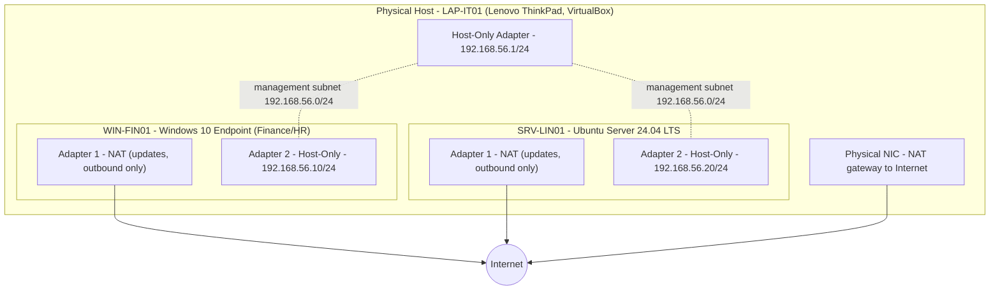

# Network & Virtual Lab Topology

> **Version:** v1.0 · **Date:** 2026-11-24 · **Owner:** IT Support · **Scope:** Savannah Logistics Ltd. lab network

## 1. Topology Diagram



## 2. Dual-Interface Design

Every virtual machine uses two network paths, separated by function:

| Interface | Type | Purpose | Security posture |
|---|---|---|---|
| Adapter 1 | NAT | Pull OS security updates, reach the internet | Outbound-only; VMs are not directly addressable from external networks |
| Adapter 2 | Host-Only | All internal traffic: remote administration, diagnostics (ping, DNS tests), file transfer, port scans | Isolated on 192.168.56.0/24; no route to the physical LAN or internet |

**Why this matters:** if an endpoint is compromised, the attacker's foothold is bounded by the host-only segment — the lab's management traffic and the endpoint's internet access never share a path. In production this maps to a dedicated VLAN for management.

## 3. IP Addressing Plan

| Node | Role | Interface | IP address | Notes |
|---|---|---|---|---|
| LAP-IT01 | Helpdesk Control Node (physical host) | Host-Only | 192.168.56.1 | VirtualBox Host-Only Ethernet Adapter; runs diagnostics, scans, backup verification |
| WIN-FIN01 | Windows 10 endpoint (Finance/HR user) | Host-Only | 192.168.56.10 | Static assignment; NAT adapter uses DHCP |
| SRV-LIN01 | Ubuntu Server 24.04 LTS | Host-Only | 192.168.56.20 | Static assignment via netplan; NAT adapter uses DHCP |
| — | Production: user workstations | — | 192.168.56.100–200 | DHCP pool reserved. The lab uses static addressing for determinism; see Design Notes |

Subnet: `192.168.56.0/24` · Mask: `255.255.255.0` · Broadcast: `192.168.56.255`

## 4. Name Resolution

Support staff troubleshoot by machine name, not raw IP. **Lab implementation:** hosts-file entries (zero-infrastructure equivalent of the production internal DNS design). The exact entries, applied identically on the host and both VMs:

```
192.168.56.1    LAP-IT01
192.168.56.10   WIN-FIN01
192.168.56.20   SRV-LIN01
```

- Windows (`C:\Windows\System32\drivers\etc\hosts`) — requires elevated editor
- Linux (`/etc/hosts`)

**Production design note:** a real deployment runs an internal DNS server (or router-based resolution) so name mapping is centralized and survives machine rebuilds; hosts files are the deliberate zero-cost lab equivalent.

## 5. Firewall Scope Summary

Inbound access is scoped to the management subnet only — nothing else can reach the endpoints:

| Node | Allowed inbound | Scope | Enforced by |
|---|---|---|---|
| WIN-FIN01 | RDP (TCP 3389) | 192.168.56.0/24 only | Defender Firewall scoped rule |
| WIN-FIN01 | ICMPv4 echo (diagnostics) | 192.168.56.0/24 only | Defender Firewall scoped rule |
| SRV-LIN01 | SSH (TCP 22) | 192.168.56.0/24 only | UFW rule |

All other inbound traffic: blocked/filtered by default on both nodes. Verified empirically in [T-03 port scan](../05-validation-evidence/test_results.md#t-03--port-scan-against-hardened-endpoints).

## 6. Design Notes

- **Workgroup, not domain:** at 40 employees with a zero-cost mandate, local accounts + local groups + documented RBAC (see [rbac-matrix.md](../02-identity-and-access/rbac-matrix.md)) deliver the same least-privilege outcome without Active Directory infrastructure. The JML policy and RBAC matrix are written so a future domain migration is a lift-and-shift.
- **DHCP:** production deployments assign user workstations leases from the reserved pool (192.168.56.100–200); servers and admin nodes stay static so diagnostics never chase moving targets.
- **NAT for updates:** endpoints never host services reachable from the internet side; the NAT path exists purely so patches and signature updates arrive.
