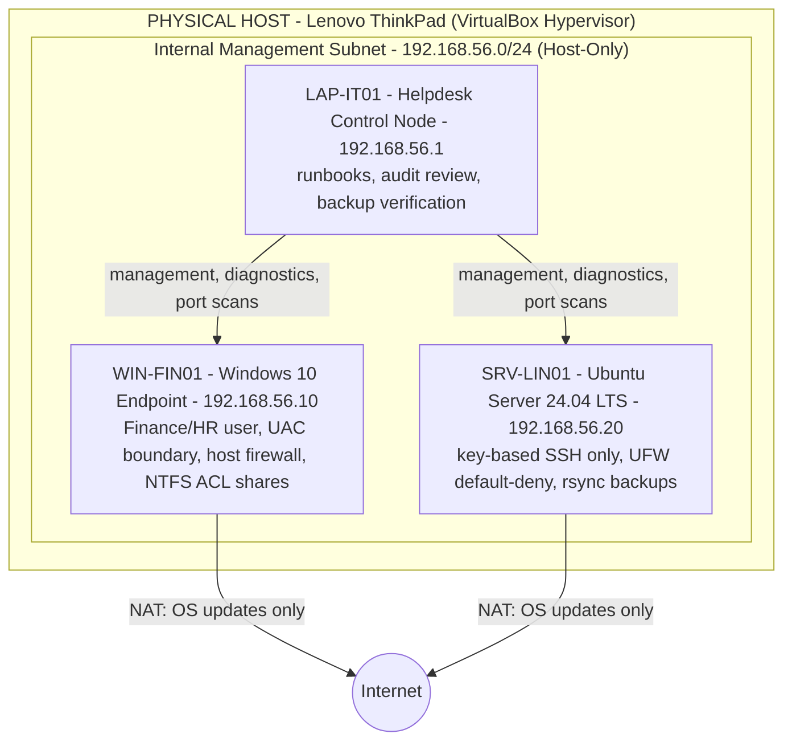

# Automated SME Helpdesk, Access Governance & Dual-OS Endpoint Hardening Architecture

> **Project 1** — aligned to the Google IT Support Professional Certificate
> **Role:** Junior Systems & IT Support Architect · **Version:** v1.0 · **Date:** 2026-11-24
> **Simulated client:** Savannah Logistics Ltd., Nairobi

## 1. The Business Problem

Savannah Logistics Ltd. is a fast-growing 40-employee logistics company in Nairobi running a mixed Windows and Linux environment. The company hired IT support to solve four recurring pain points:

1. **Shared administrator passwords** — everyone knows the same admin credential, so malware infections and accidental deletions cannot be traced to a person.
2. **Slow, inconsistent onboarding** — new hires take ~2 days to set up manually, and each workstation ends up with different software and security settings.
3. **Chaotic troubleshooting** — when Wi-Fi, DNS, or printers fail, there is no repeatable diagnostic procedure; every incident is solved from scratch.
4. **No backups or audit trail** — deleted files are gone forever, and nobody can tell who changed what on company computers.

## 2. Architecture at a Glance



## 3. The Five Architectural Pillars

| Pillar | What it delivers | Where documented |
|---|---|---|
| 1. Network & Virtual Lab Design | Dual-interface networking (NAT for updates, host-only 192.168.56.0/24 for management), static addressing, name resolution | [01-architecture/network-topology.md](01-architecture/network-topology.md), [vm-inventory.md](01-architecture/vm-inventory.md) |
| 2. Identity & Access Lifecycle | Joiner–Mover–Leaver policy, standard/admin account separation, departmental RBAC, 15-minute onboarding, 5-point offboarding | [02-identity-and-access/jml-policy.md](02-identity-and-access/jml-policy.md), [rbac-matrix.md](02-identity-and-access/rbac-matrix.md) |
| 3. Dual-OS Hardening Baseline | Golden-standard checklists every machine must pass before handover (Windows + Linux) | [03-hardening-baselines/windows-baseline.md](03-hardening-baselines/windows-baseline.md), [linux-baseline.md](03-hardening-baselines/linux-baseline.md) |
| 4. IT Service Management & Diagnostics | Five Tier-1/Tier-2 runbooks: Symptom → OSI-layer isolation → Verification → Root-cause prevention | [04-troubleshooting-runbooks/](04-troubleshooting-runbooks/) |
| 5. Backup, Change Management & Auditability | 3-2-1 backup with tested restores, pre/post-change snapshots, retained security events | [05-validation-evidence/test_results.md](05-validation-evidence/test_results.md), [06-lab-build/lab-build-guide.md](06-lab-build/lab-build-guide.md) |

## 4. Technologies

VirtualBox (hypervisor) · Windows 10 (endpoint) · Ubuntu Server 24.04 LTS (server) · Windows Defender & Defender Firewall · NTFS ACLs · UFW · fail2ban · unattended-upgrades · OpenSSH (key-based) · rsync (3-2-1 backups) · mermaid (diagrams)

## 5. Verification & Testing Matrix

Every claim in this repository is backed by a test that was actually executed in the lab. Evidence lives in [05-validation-evidence/](05-validation-evidence/).

| Test ID | Scenario tested | Expected architectural result | Status |
|---|---|---|---|
| [T-01](05-validation-evidence/test_results.md#t-01--standard-user-privilege-boundary) | Standard user tries to install unapproved software or change firewall settings | Blocked by UAC / privilege boundary | ⏳ Pending — capture in lab session |
| [T-02](05-validation-evidence/test_results.md#t-02--linux-ssh-key-only-enforcement) | Password-based / direct root SSH login to Linux node | Connection rejected; key-only auth enforced | ⏳ Pending — capture in lab session |
| [T-03](05-validation-evidence/test_results.md#t-03--port-scan-against-hardened-endpoints) | Port scan against hardened Windows & Linux endpoints | Only explicitly permitted ports respond | ⏳ Pending — capture in lab session |
| [T-04](05-validation-evidence/test_results.md#t-04--rbac-folder-access-control) | Finance user attempts to open IT Admin restricted folder | Access denied by group-level ACL | ⏳ Pending — capture in lab session |
| [T-05](05-validation-evidence/test_results.md#t-05--dns-failure-isolation-runbook-a) | Simulated DNS failure on workstation | Runbook A isolates failure to the DNS layer | ⏳ Pending — capture in lab session |
| [T-06](05-validation-evidence/test_results.md#t-06--backup-restore) | Accidental file deletion by staff member | File restored from scheduled backup | ⏳ Pending — capture in lab session |

## 6. Repository Map

```
01-it-support-endpoint-hardening-lab/
├── README.md                          ← you are here
├── 01-architecture/                   network topology, IP plan, VM inventory
├── 02-identity-and-access/            JML policy, RBAC matrix, on/offboarding checklists
├── 03-hardening-baselines/            Windows + Linux golden-standard checklists
├── 04-troubleshooting-runbooks/       Runbooks A–E (Tier-1/Tier-2 SOPs)
├── 05-validation-evidence/            test_results.md + screenshot evidence
└── 06-lab-build/                      click-by-click build guide + hardening scripts
    └── scripts/                       linux-hardening.sh · windows-hardening.ps1 · backup-restore.sh
```

## 7. Rebuilding This Lab

The entire environment can be rebuilt from zero on any 2-core / 8 GB machine using only free software. Follow [06-lab-build/lab-build-guide.md](06-lab-build/lab-build-guide.md) step by step, then run the three scripts in `06-lab-build/scripts/`. All evidence in `05-validation-evidence/` comes from executing the validation matrix against this lab — nothing is simulated on paper.
