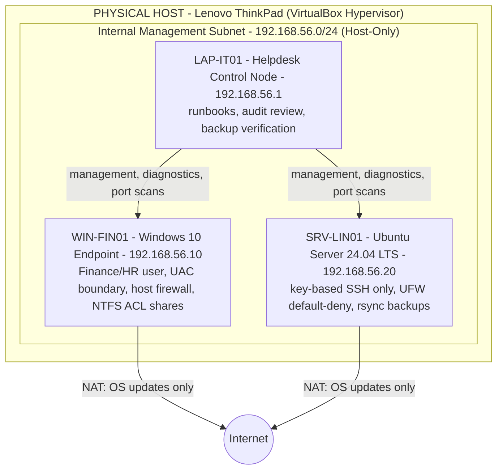

# Automated SME Helpdesk, Access Governance & Dual-OS Endpoint Hardening Architecture

> **Project 1** — aligned to the Google IT Support Professional Certificate
> **Role:** Junior Systems & IT Support Architect · **Version:** v1.2 · **Date:** 2026-11-24
> **Simulated client:** Savannah Logistics Ltd., Nairobi

**▶ [OPEN THE LIVE INTERACTIVE LAB](https://peterken-365.github.io/-Automated-SME-Helpdesk-Access-Governance-Dual-OS-Endpoint-Hardening-Architecture/lab/)** — runs in your browser, nothing to install.
[](https://github.com/peterken-365/-Automated-SME-Helpdesk-Access-Governance-Dual-OS-Endpoint-Hardening-Architecture/actions/workflows/script-validation.yml)

## ▶ Try the Interactive Lab

No installation needed: a browser-based simulation of this lab — six guided walkthroughs of the validation tests plus a free-play terminal with ~20 working commands — is **live here**: [peterken-365.github.io/…/lab](https://peterken-365.github.io/-Automated-SME-Helpdesk-Access-Governance-Dual-OS-Endpoint-Hardening-Architecture/lab/). It is a **demonstration of the architecture**, clearly labeled as a simulation; the authoritative evidence lives in [05-validation-evidence/test_results.md](05-validation-evidence/test_results.md). All six guided tests have been executed end-to-end in this simulator — full transcripts, linked per test, in that same file.

**New — Incident Challenges:** the simulator now *breaks the lab for real* (DNS outage, deleted file, SSH lockout), and you diagnose it in the free-play terminal and type the actual fix command. Scored PASS/hand-over, hints staged, every challenge linked to the runbook it exercises.

## 1. The Business Problem

Savannah Logistics Ltd. is a fast-growing 40-employee logistics company in Nairobi running a mixed Windows and Linux environment. The company hired IT support to solve four recurring pain points:

1. **Shared administrator passwords** — everyone knows the same admin credential, so malware infections and accidental deletions cannot be traced to a person.
2. **Slow, inconsistent onboarding** — new hires take ~2 days to set up manually, and each workstation ends up with different software and security settings.
3. **Chaotic troubleshooting** — when Wi-Fi, DNS, or printers fail, there is no repeatable diagnostic procedure; every incident is solved from scratch.
4. **No backups or audit trail** — deleted files are gone forever, and nobody can tell who changed what on company computers.

## 2. Architecture at a Glance



## 3. The Five Architectural Pillars

| Pillar | What it delivers | Where documented |
|---|---|---|
| 1. Network & Virtual Lab Design | Dual-interface networking (NAT for updates, host-only 192.168.56.0/24 for management), static addressing, name resolution | [01-architecture/network-topology.md](01-architecture/network-topology.md), [vm-inventory.md](01-architecture/vm-inventory.md) |
| 2. Identity & Access Lifecycle | Joiner–Mover–Leaver policy, standard/admin account separation, departmental RBAC, 15-minute onboarding, 5-point offboarding | [02-identity-and-access/jml-policy.md](02-identity-and-access/jml-policy.md), [rbac-matrix.md](02-identity-and-access/rbac-matrix.md) |
| 3. Dual-OS Hardening Baseline | Golden-standard checklists every machine must pass before handover (Windows + Linux) | [03-hardening-baselines/windows-baseline.md](03-hardening-baselines/windows-baseline.md), [linux-baseline.md](03-hardening-baselines/linux-baseline.md) |
| 4. IT Service Management & Diagnostics | Five Tier-1/Tier-2 runbooks: Symptom → OSI-layer isolation → Verification → Root-cause prevention | [Runbook A](04-troubleshooting-runbooks/runbook-a-no-internet.md) · [B](04-troubleshooting-runbooks/runbook-b-access-denied.md) · [C](04-troubleshooting-runbooks/runbook-c-slow-workstation.md) · [D](04-troubleshooting-runbooks/runbook-d-malware.md) · [E](04-troubleshooting-runbooks/runbook-e-ssh-refused.md) |
| 5. Backup, Change Management & Auditability | 3-2-1 backup with tested restores, pre/post-change snapshots, retained security events | [05-validation-evidence/test_results.md](05-validation-evidence/test_results.md), [06-lab-build/lab-build-guide.md](06-lab-build/lab-build-guide.md) |

## 4. Technologies

VirtualBox (hypervisor) · Windows 10 (endpoint) · Ubuntu Server 24.04 LTS (server) · Windows Defender & Defender Firewall · NTFS ACLs · UFW · fail2ban · unattended-upgrades · OpenSSH (key-based) · rsync (3-2-1 backups) · mermaid (diagrams)

## 5. Verification & Testing Matrix

Every claim in this repository is backed by a test, and every result is produced in three tiers — no result is written before its test has run. Evidence lives in [05-validation-evidence/test_results.md](05-validation-evidence/test_results.md).

1. **Tier 1 — Script pre-validation:** the repository's own scripts executed in a sandbox shell (real exit codes, checksums, inode dedup), plus machine validation of every script: `bash -n` gate, ShellCheck v0.10.0 (zero findings at style level), an sshd_config transform unit test, and a PowerShell 7.4.6 AST parse of the Windows script — all re-run by [GitHub Actions](https://github.com/peterken-365/-Automated-SME-Helpdesk-Access-Governance-Dual-OS-Endpoint-Hardening-Architecture/blob/main/.github/workflows/script-validation.yml) on every push. Raw logs: `05-validation-evidence/prevalidation-logs/`.
2. **Tier 2 — Simulator E2E:** all six tests driven end-to-end through the [interactive lab](lab/) UI on **2026-11-24** — desktop and mobile viewports, zero console errors, including the T-01 UAC dialog. Proves the architecture's decision paths behave exactly as designed.
3. **Tier 3 — Physical lab capture:** the same six tests re-run on the real VirtualBox endpoints with screenshots, per the [lab build guide](06-lab-build/lab-build-guide.md). **In progress:** SRV-LIN01 was built, hardened and snapshotted on 2026-11-24, and the Linux-side legs (T-02, T-03 SRV-LIN01, T-06) already executed on the real endpoint — transcripts: [T-02](05-validation-evidence/prevalidation-logs/T-02-ssh-keyonly-realvm.log) · [T-03 Linux leg](05-validation-evidence/prevalidation-logs/T-03-port-scan-realvm-linux.log) · [T-06](05-validation-evidence/prevalidation-logs/T-06-backup-restore-realvm.log). Remaining: WIN-FIN01 build + its test legs + PNG screenshot capture.

| Test ID | Scenario tested | Expected architectural result | Simulator E2E (Tier 2) | Physical lab (Tier 3) |
|---|---|---|---|---|
| [T-01](05-validation-evidence/test_results.md#t-01--standard-user-privilege-boundary) | Standard user tries to install unapproved software or change firewall settings | Blocked by UAC / privilege boundary | ✅ Verified 2026-11-24 | ⏳ Pending |
| [T-02](05-validation-evidence/test_results.md#t-02--linux-ssh-key-only-enforcement) | Password-based / direct root SSH login to Linux node | Connection rejected; key-only auth enforced | ✅ Verified 2026-11-24 | ✅ Executed on real VM 2026-11-24 (transcript) · PNGs pending |
| [T-03](05-validation-evidence/test_results.md#t-03--port-scan-against-hardened-endpoints) | Port scan against hardened Windows & Linux endpoints | Only explicitly permitted ports respond | ✅ Verified 2026-11-24 | 🔶 SRV-LIN01 leg executed on real VM 2026-11-24 (transcript) · WIN-FIN01 leg + PNGs pending |
| [T-04](05-validation-evidence/test_results.md#t-04--rbac-folder-access-control) | Finance user attempts to open IT Admin restricted folder | Access denied by group-level ACL | ✅ Verified 2026-11-24 | ⏳ Pending |
| [T-05](05-validation-evidence/test_results.md#t-05--dns-failure-isolation-runbook-a) | Simulated DNS failure on workstation | Runbook A isolates failure to the DNS layer | ✅ Verified 2026-11-24 | ⏳ Pending |
| [T-06](05-validation-evidence/test_results.md#t-06--backup-restore) | Accidental file deletion by staff member | File restored from scheduled backup | ✅ Verified 2026-11-24 — plus a real `backup-restore.sh` run (Tier 1): bit-identical restore | ✅ Executed on real VM 2026-11-24 (transcript) · PNGs pending |

## 6. Repository Map

```
-Automated-SME-Helpdesk-Access-Governance-Dual-OS-Endpoint-Hardening-Architecture/
├── README.md                          ← you are here
├── 01-architecture/                   network topology, IP plan, VM inventory
├── 02-identity-and-access/            JML policy, RBAC matrix, on/offboarding checklists
├── 03-hardening-baselines/            Windows + Linux golden-standard checklists
├── 04-troubleshooting-runbooks/       Runbooks A–E (Tier-1/Tier-2 SOPs)
├── 05-validation-evidence/            test_results.md · prevalidation-logs/ · screenshots (Tier 3)
├── 06-lab-build/                      click-by-click build guide + hardening scripts
│   ├── Vagrantfile                    ▶ one-command automated build of SRV-LIN01
│   └── scripts/                       linux-hardening.sh · windows-hardening.ps1 · backup-restore.sh
│       └── tests/                     sshd_config transform unit test (CI-run)
└── lab/                               ▶ interactive browser simulator (zero-install demo)
```

## 7. Rebuilding This Lab

The entire environment can be rebuilt from zero on any 2-core / 8 GB machine using only free software. Follow [06-lab-build/lab-build-guide.md](06-lab-build/lab-build-guide.md) step by step, then run the three scripts in `06-lab-build/scripts/`. The Linux node can also be brought up in one command with the included Vagrantfile (`vagrant up` inside `06-lab-build/`) — it applies the hardening script as its provisioner, unmodified. GitHub Actions re-validates all three scripts on every push (badge above). Validation follows the three-tier model in [05-validation-evidence/test_results.md](05-validation-evidence/test_results.md): scripts are pre-validated by real execution, the six tests' decision paths are proven end-to-end in the browser simulator, and every test ships with a physical capture checklist — so when you build the lab, each checklist item turns a verified result into on-the-metal screenshot evidence.
